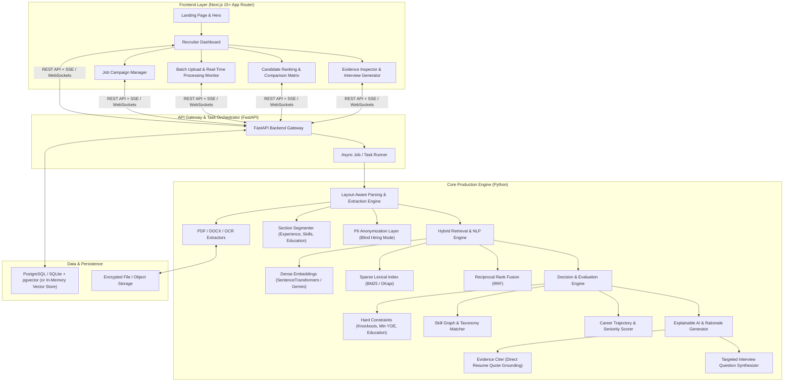

# ResumeRank Enterprise · Production Architecture & Implementation Plan

## 1. Architectural Vision & System Design

ResumeRank is transitioning from a single-file Streamlit script into a full-stack, decoupled, enterprise-grade hiring intelligence platform:

1. **Frontend**: Modern **Next.js (App Router, React 19, TypeScript, Tailwind CSS, shadcn/ui)** with bespoke, editorial aesthetics—avoiding generic "AI slop" neon purples and clichéd gradient bloat. Crisp typography (Geist / Inter), subtle glassmorphism, semantic neutral tones (zinc/slate), enterprise navigation, and interactive dashboards.
2. **Backend & Core Engine**: High-performance **FastAPI (Python 3.11+)** service featuring asynchronous processing, layout-aware multi-format document ingestion, hybrid scoring (Dense Vector Embeddings + BM25 Lexical Ranking), deterministic constraint evaluation, and evidence-grounded AI decision reasoning.



---

## 2. Component Specifications

### 2.1. Frontend: Professional Next.js Experience
* **Design Philosophy**:
  * **Anti-AI Slop**: Steer completely clear of default purple/pink glowing neon cards, generic pulsing planetary orbs, and generic template styling.
  * **Enterprise Aesthetic**: Clean slate/zinc neutral palette, surgical micro-borders (`border-zinc-800`), deep matte charcoal/monochrome backgrounds with focused accent tones (e.g. International Klein Blue or emerald matching cues), crisp typography (`Geist Sans` & `Geist Mono`), and deliberate spacing.
* **Key Pages & Views**:
  1. **Marketing & Hero Page**:
     - Sticky executive navigation bar with product capabilities, metrics, documentation links, and quick login.
     - High-impact value proposition: "High-Precision Candidate Intelligence. Less Bias, Zero Hallucinations."
     - Live interactive demo component (interactive mini-matcher widget).
  2. **Campaign / Role Workspace**:
     - Job Description editor with live requirement extraction (must-have vs. nice-to-have skills, seniority target, education requirements).
     - Drag-and-drop batch resume uploadzone supporting 50+ files with client-side validation and immediate visual feedback.
  3. **Live Ingestion Monitor**:
     - Real-time progress bars via Server-Sent Events (SSE) showing parsing, entity extraction, embedding generation, and scoring status per resume.
  4. **Recruiter Command Center & Leaderboard**:
     - Sortable candidate matrix with composite scores, radar charts, skill gap badges, and detected years of experience.
     - "Blind Screening Mode" toggle: instantly masks candidate names, genders, photos, graduation years, and geographic locations to eliminate unconscious hiring bias.
  5. **Candidate Deep Dive & Evidence Inspector**:
     - Side-by-side view: Original resume text highlighted with matched requirement citations.
     - Explainable score breakdown (Dense Semantic Match, Keyword Overlap, Career Progression, Domain Fit).
     - AI-generated interview question prep tailored specifically to gaps identified in the candidate's history.
  6. **Side-by-Side Candidate Comparison**:
     - Head-to-head comparison tool evaluating 2 to 4 candidates across skill coverage, seniority, and specific JD clauses.

---

### 2.2. Backend & Core Engine: Production-Grade Processing

#### A. Document Parsing & Section Segmentation
* **Multi-Format Ingestion**:
  * Native PDF parsing using `pdfplumber` / `pypdfium2` with layout analysis to prevent multi-column reading order corruption.
  * DOCX processing via `python-docx` with XML structure preservation.
  * OCR fallback via `pytesseract` for rasterized/scanned PDF resumes.
* **Structure & Entity Extraction**:
  * Smart section chunking: Identifies *Summary*, *Experience*, *Education*, *Skills*, *Projects*, and *Certifications*.
  * True Entity Extraction: Regex + NLP extractors for candidate contact details (Email, Phone, LinkedIn, GitHub, Location) and candidate full name (detecting from header blocks, not file names).
  * Temporal Experience Engine: Parses date ranges (e.g., `Mar 2020 – Present`, `2018 - 2021`) to accurately calculate net commercial experience, accounting for overlapping roles and career breaks.

#### B. NLP, Hybrid Search & Semantic Matching
* **Dual-Track Hybrid Ranking**:
  * **Dense Semantic Matching**: Encodes JD clauses and resume experience sections using state-of-the-art embedding models (`sentence-transformers/all-MiniLM-L6-v2` or Google Gemini Text Embeddings). Captures implicit contextual equivalence (e.g. "Distributed stream processing" $\leftrightarrow$ "Apache Kafka & Flink").
  * **Sparse Lexical Ranking (BM25)**: Evaluates exact technical keywords, certifications, and tooling tokens to guarantee critical terminology is not lost in embedding compression.
  * **Reciprocal Rank Fusion (RRF)**: Merges dense and sparse ranks mathematically into a unified relevance score.
* **Multi-Tier Decision Engine**:
  1. *Tier 1: Knockout Filters* — Flags hard blockers (e.g., minimum required experience, mandatory clearance/certifications).
  2. *Tier 2: Skill Graph Evaluation* — Differentiates between core languages/frameworks and tangential tools.
  3. *Tier 3: Trajectory & Seniority Analysis* — Assesses career velocity, promotion patterns, and relevance of recent roles compared to older positions.

#### C. Explainable AI (XAI) & Bias Mitigation
* **Grounded Match Rationales**:
  * For every candidate, the engine outputs a structured verdict with exact text evidence quoted directly from the resume. No black-box scores.
* **Fairness & Anonymization**:
  * Built-in PII redaction layer that can produce sanitized representations for fair screening.

---

## 3. Recommended Project Structure

```
Resume Ranker/
├── PLAN.md                               # Project execution blueprint
├── docker-compose.yml                    # Local full-stack orchestration
├── backend/                              # FastAPI Core Engine
│   ├── pyproject.toml / requirements.txt
│   ├── Dockerfile
│   ├── app/
│   │   ├── main.py                       # FastAPI entrypoint & middleware
│   │   ├── api/                          # REST & SSE endpoints
│   │   │   ├── routes_jobs.py            # JD management
│   │   │   ├── routes_resumes.py         # Upload & parsing endpoints
│   │   │   └── routes_ranking.py         # Ranking & analytics queries
│   │   ├── core/                         # Config, logging, settings
│   │   ├── parsers/                      # Layout-aware document readers
│   │   │   ├── pdf_parser.py
│   │   │   ├── docx_parser.py
│   │   │   └── ocr_engine.py
│   │   ├── extractors/                   # Information & section extraction
│   │   │   ├── contact_extractor.py
│   │   │   ├── experience_calculator.py
│   │   │   ├── section_segmenter.py
│   │   │   └── anonymizer.py
│   │   ├── nlp/                          # NLP & Vector search
│   │   │   ├── embeddings.py             # Dense embedding wrappers
│   │   │   ├── bm25_ranker.py            # Sparse lexical scoring
│   │   │   └── taxonomy.py               # Skill taxonomy mappings
│   │   ├── engine/                       # Decision & Scoring logic
│   │   │   ├── scorer.py                 # Multi-factor weighted composite
│   │   │   ├── constraints.py            # Knockout checks
│   │   │   └── reasoning.py              # Evidence citing & interview prep
│   │   └── schemas/                      # Pydantic models (Job, Candidate, Score)
│   └── tests/                            # Pytest test suite
│
├── frontend/                             # Next.js 15+ App
│   ├── package.json
│   ├── tsconfig.json
│   ├── tailwind.config.ts
│   ├── next.config.ts
│   ├── public/
│   └── src/
│       ├── app/
│       │   ├── layout.tsx                # Root layout with fonts & theme provider
│       │   ├── page.tsx                  # Landing page with hero & navbar
│       │   ├── dashboard/
│       │   │   ├── page.tsx              # Recruiter campaign dashboard
│       │   │   ├── [jobId]/
│       │   │   │   ├── upload/page.tsx   # Batch resume upload & live monitor
│       │   │   │   ├── candidates/page.tsx# Leaderboard & filter controls
│       │   │   │   └── compare/page.tsx  # Side-by-side comparison
│       ├── components/
│       │   ├── layout/                   # Navbar, Sidebar, Footer
│       │   ├── ui/                       # Buttons, Dialogs, Cards, Badges, Tabs
│       │   ├── dashboard/                # Candidate cards, Radar charts, Progress
│       │   └── evidence/                 # Resume quote viewer & breakdown modal
│       ├── lib/                          # API client, SSE subscriber, utils
│       └── types/                        # TypeScript domain interfaces
```

---

## 4. Phased Implementation Roadmap

### Phase 1: Engine Foundation & Backend API
* Initialize clean monorepo or dual-directory setup (`backend/` and `frontend/`).
* Build FastAPI service scaffolding with async endpoints for health checks, job creation, and file uploads.
* Implement the new modular parsing subsystem:
  * Layout-safe PDF text & table extraction.
  * Section segmenter to separate Experience from Education and Skills.
  * Robust YOE date-range parser.
* Add initial `pytest` suite testing parsers against varied resume formats.

### Phase 2: Next-Gen Decision & Scoring Engine
* Implement the hybrid scoring pipeline:
  * Dense embedding generation with fallback cache.
  * BM25 ranker for exact keyword and accreditation verification.
  * Reciprocal rank fusion and configurable weight profiles (Generalist, Specialist, Leadership).
* Build the Evidence Grounding module:
  * Match JD bullet points against specific resume clauses with character-offset citations.
* Implement structured PII anonymizer for bias-free evaluation mode.

### Phase 3: Professional Next.js Frontend
* Initialize Next.js project with Tailwind CSS, shadcn/ui components, and Lucide icons.
* Develop the executive landing page:
  * Bespoke hero section with typography-driven layout, micro-interactions, and live interactive demo.
  * Clean modern navigation bar with dark/light theme support.
* Develop the Recruiter Workspace:
  * Drag-and-drop batch uploader with live streaming status indicators (SSE).
  * Interactive candidate leaderboard with multi-factor filters, score distribution histograms, and blind screening toggles.
  * Candidate Inspection Drawer: Shows highlighted resume snippet citations and custom interview question suggestions.
  * Comparison View: Compare top 3 candidates head-to-head.

### Phase 4: Integration, Polish & Dockerization
* Connect Frontend and Backend with full type-safe contracts (`types/`).
* Optimize performance with background caching of vector embeddings.
* Provide Dockerfile configurations and `docker-compose.yml` to spin up the entire system with one command (`docker-compose up`).
