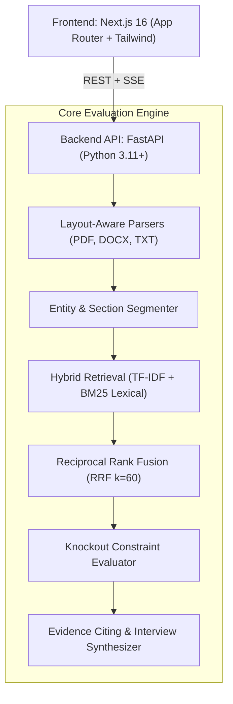

# ResumeRank Enterprise · Production Hiring Intelligence Engine

ResumeRank is an enterprise-grade candidate matching and ranking platform. It fuses **Dense Semantic Embeddings** with **Sparse BM25 Lexical Verification** via **Reciprocal Rank Fusion (RRF)**, evaluates **Hard Knockout Constraints**, extracts **Direct Text Evidence Citations**, and provides a **Blind Screening Mode** to eradicate hiring bias.

---

## Key Capabilities

- **Editorial, Anti-Slop Next.js 16 UI**: Bespoke dark slate palette (`zinc-950`), subtle borders, crisp typography via Geist Sans/Mono, avoiding generic purple AI gradient templates.
- **Dual Hybrid Fusion**: Combines semantic cosine similarity and Okapi BM25 lexical ranking into a unified relevance score.
- **Section-Weighted Analysis**: Applies 2x weight to demonstrated hands-on accomplishments in Work Experience sections over passive skill listings.
- **Grounded Evidence Engine**: Cites exact resume text excerpts justifying every match score—eliminating hallucinations.
- **Hard Knockout Evaluation**: Enforces non-negotiable criteria (mandatory skills, minimum YOE, minimum degrees) with automated demotion.
- **Blind Screening Mode**: One-click PII and institution redaction protecting against unconscious pedigree and age bias.
- **Tailored Screening Questions**: Automatically synthesizes technical interview questions targeted at candidate skill gaps.
- **Head-to-Head Comparison**: Compare 2 to 4 candidates side-by-side across all competencies and metrics.

---

## Architecture Overview



---

## Project Structure

```
Resume Ranker/
├── backend/                              # FastAPI Python Service
│   ├── Dockerfile
│   ├── app/
│   │   ├── main.py                       # API entrypoint & CORS middleware
│   │   ├── core/                         # Configuration & in-memory session store
│   │   ├── schemas/                      # Pydantic domain models
│   │   ├── parsers/                      # Layout-aware PDF/DOCX/TXT parsers
│   │   ├── extractors/                   # Contact, name, YOE, education, anonymizer
│   │   ├── nlp/                          # Taxonomy, tokenizer, BM25, embeddings, RRF fusion
│   │   ├── engine/                       # Multi-factor scoring, evidence citing, knockouts
│   │   └── api/                          # REST endpoints (health, jobs, resumes, ranking)
│   └── tests/                            # Comprehensive Pytest test suite
│
├── frontend/                             # Next.js 16 App Router
│   ├── Dockerfile
│   ├── src/
│   │   ├── app/                          # Layout & root page
│   │   ├── components/
│   │   │   ├── layout/                   # Navbar, Footer
│   │   │   ├── hero/                     # HeroSection with live metrics preview
│   │   │   ├── workspace/                # RecruiterWorkspace, CandidateModal, ComparisonModal
│   │   │   └── landing/                  # ArchitectureSection
│   │   ├── lib/                          # API client & mock campaign data
│   │   └── types/                        # TypeScript domain interfaces
│
├── docker-compose.yml                    # Full-stack container orchestration
├── dev.sh                                # Local concurrent development script
├── PLAN.md                               # Project roadmap & architecture blueprint
└── requirements.txt                      # Python dependencies
```

---

## Quickstart Guide

### Option 1: Local Development (Recommended)

1. **Activate Python Virtual Environment & Install Dependencies**:
   ```bash
   python3 -m venv venv
   source venv/bin/activate
   pip install -r requirements.txt
   ```

2. **Install Frontend Dependencies**:
   ```bash
   cd frontend
   npm install
   cd ..
   ```

3. **Launch Both Services Concurrently**:
   ```bash
   ./dev.sh
   ```
   * **Frontend UI**: [http://localhost:3000](http://localhost:3000)
   * **FastAPI Interactive Docs**: [http://localhost:8000/docs](http://localhost:8000/docs)

---

### Option 2: Docker Compose

Spin up the entire decoupled system with one command:
```bash
docker compose up --build
```

---

## Running the Automated Test Suite

### Backend Unit & Integration Tests (15 Tests)
```bash
source venv/bin/activate
PYTHONPATH=. pytest -v backend/tests
```

### Frontend Type-Check & Build
```bash
cd frontend
npm run build
```

---

## License
MIT
