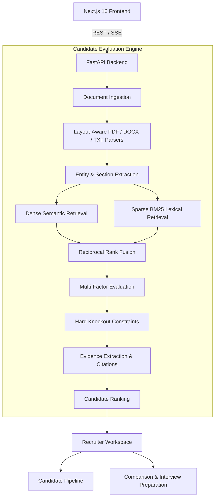

<div align="center">

  

  <br/>

**An intelligent candidate matching, ranking, and recruitment pipeline platform.**

[](https://www.python.org/)
[](https://nextjs.org/)
[](https://fastapi.tiangolo.com/)
[](https://www.typescriptlang.org/)
[](https://www.docker.com/)
[](LICENSE)

---

**People Lens** transforms traditional resume screening into an intelligent, evidence-backed evaluation process. By combining semantic understanding, lexical matching, and structured candidate assessment, it helps recruiters identify relevant talent, understand candidate strengths, and manage the recruitment lifecycle.

</div>

---

## Overview

Recruiters often deal with hundreds of resumes for a single position. Traditional keyword-based screening can overlook qualified candidates, while manual evaluation is time-consuming and difficult to standardize.

People Lens addresses this challenge through a hybrid candidate evaluation engine that analyzes resumes against job requirements, generates explainable relevance scores, identifies skill gaps, and organizes candidates through a structured recruitment pipeline.

Rather than relying exclusively on keyword matching or opaque AI-generated scores, People Lens combines multiple evaluation signals with direct textual evidence from candidate resumes.

## Key Features

### Intelligent Candidate Matching

- **Hybrid Semantic and Lexical Matching:** Combines dense semantic embeddings with sparse BM25 lexical retrieval.
- **Reciprocal Rank Fusion (RRF):** Combines independent retrieval rankings into a unified relevance ranking.
- **Section-Weighted Evaluation:** Prioritizes demonstrated professional accomplishments and hands-on experience over passive skill listings.
- **Multi-Factor Scoring:** Evaluates semantic relevance, technical competencies, experience alignment, and domain relevance.

### Evidence-Based Evaluation

- **Direct Resume Citations:** Extracts relevant textual excerpts supporting individual competency assessments.
- **Skill Gap Identification:** Highlights matched, missing, and unverified job requirements.
- **Hard Knockout Constraints:** Evaluates configurable mandatory skills, minimum experience, and educational requirements.
- **Candidate Evaluation Breakdown:** Provides transparent scoring dimensions and hiring rationales.

### Recruitment Pipeline Management

- **Kanban Pipeline:** Organizes candidates across recruitment stages.
- **Stage Transitions:** Move candidates through Applied, Shortlisted, Interview, Selected, and Rejected.
- **Candidate Tracking:** Maintains recruitment-stage information independently of AI-generated match scores.
- **Campaign-Based Organization:** Manage candidate evaluations within individual recruitment campaigns.

### Advanced Recruitment Tools

- **Blind Screening Mode:** Redacts selected personally identifiable information and institution details to help reduce potential screening bias.
- **Interview Question Generation:** Generates candidate-specific technical questions based on identified competencies and skill gaps.
- **Head-to-Head Comparison:** Compare 2–4 candidates across evaluation dimensions, skills, and recruitment status.
- **Recruiter Analytics:** Review screening statistics, match distributions, and campaign outcomes.

### Modern User Interface

- Next.js 16 App Router architecture.
- Responsive recruiter workspace.
- Dark and light theme support.
- Candidate leaderboard and detailed evaluation views.
- Interactive candidate pipeline.
- Clean typography using Geist Sans and Geist Mono.

---

## System Architecture

People Lens uses a decoupled frontend and backend architecture, with the candidate evaluation engine organized into independent processing stages.



### Technology Stack

| Layer | Technologies |
|---|---|
| Frontend | Next.js 16, React, TypeScript |
| Styling | Tailwind CSS, Geist Sans, Geist Mono |
| Backend | Python 3.11+, FastAPI |
| API Communication | REST, Server-Sent Events (SSE) |
| Semantic Retrieval | Dense Vector Embeddings |
| Lexical Retrieval | BM25, Sparse Ranking |
| Ranking Fusion | Reciprocal Rank Fusion (RRF) |
| Document Processing | PDF, DOCX, TXT Parsers |
| Data Validation | Pydantic |
| Testing | Pytest, Next.js Build |
| Containerization | Docker, Docker Compose |

---

## Candidate Evaluation Workflow

The evaluation engine follows a structured process:

1. **Job Specification:** Recruiter provides a job description and defines evaluation criteria.
2. **Resume Ingestion:** Multiple candidate resumes are uploaded and parsed.
3. **Information Extraction:** Extracts candidate details, skills, experience, education, and document sections.
4. **Hybrid Retrieval:** Calculates semantic similarity and lexical relevance independently.
5. **Rank Fusion:** Combines retrieval rankings using Reciprocal Rank Fusion.
6. **Weighted Evaluation:** Evaluates candidates across configured competency dimensions.
7. **Constraint Evaluation:** Applies mandatory requirements and knockout rules.
8. **Evidence Generation:** Extracts relevant resume excerpts supporting candidate assessments.
9. **Candidate Ranking:** Produces an ordered candidate leaderboard with explainable evaluation results.
10. **Recruitment Management:** Recruiters compare candidates and manage their progression through the hiring pipeline.

---

## Project Structure

```text
People-Lens/
│
├── backend/                         # FastAPI Backend
│   ├── Dockerfile
│   └── app/
│       ├── main.py                  # API entrypoint and CORS
│       ├── core/                    # Configuration and session management
│       ├── schemas/                 # Pydantic domain models
│       ├── parsers/                 # PDF, DOCX, TXT processing
│       ├── extractors/              # Candidate information extraction
│       ├── nlp/                     # Embeddings, BM25, RRF, tokenization
│       ├── engine/                  # Scoring, evidence, knockout evaluation
│       └── api/                     # REST API endpoints
│
│   └── tests/                       # Backend test suite
│
├── frontend/                        # Next.js Frontend
│   ├── Dockerfile
│   └── src/
│       ├── app/                     # App Router and root layout
│       ├── components/
│       │   ├── layout/              # Navbar and Footer
│       │   ├── hero/                # Landing page hero
│       │   ├── workspace/           # Recruiter workspace
│       │   └── landing/             # Landing page sections
│       ├── lib/                     # API client and utilities
│       └── types/                   # TypeScript interfaces
│
├── docker-compose.yml               # Container orchestration
├── dev.sh                           # Local development launcher
├── PLAN.md                          # Project roadmap
├── README.md                        # Project documentation
└── requirements.txt                 # Python dependencies
```

---

## Getting Started

### Prerequisites

Ensure the following tools are installed:

- Python 3.11 or later
- Node.js and npm
- Git
- Docker and Docker Compose (optional)

### Option 1: Local Development

**1. Clone the repository**

```bash
git clone <YOUR_REPOSITORY_URL>
cd "Resume Ranker"
```

**2. Create and activate a Python virtual environment**

```bash
python3 -m venv venv
source venv/bin/activate
```

**3. Install backend dependencies**

```bash
pip install -r requirements.txt
```

**4. Install frontend dependencies**

```bash
cd frontend
npm install
cd ..
```

**5. Start the application**

```bash
chmod +x dev.sh
./dev.sh
```

Once the services are running:

| Service | URL |
|---|---|
| People Lens Frontend | http://localhost:3000 |
| FastAPI Backend | http://localhost:8000 |
| Interactive API Documentation | http://localhost:8000/docs |

### Option 2: Docker Compose

Build and start the application using Docker Compose:

```bash
docker compose up --build
```

To run the containers in the background:

```bash
docker compose up --build -d
```

To stop the application:

```bash
docker compose down
```

---

## Running Tests

### Backend Tests

Activate the virtual environment:

```bash
source venv/bin/activate
```

Run the backend test suite:

```bash
PYTHONPATH=. pytest -v backend/tests
```

### Frontend Verification

Run the production build:

```bash
cd frontend
npm run build
```

---

## Design Philosophy

People Lens is built around three core principles:

| Principle | Description |
|---|---|
| Relevance | Evaluate candidates based on alignment with actual job requirements. |
| Transparency | Support evaluation results with traceable resume evidence. |
| Human Oversight | Help recruiters make informed decisions without replacing human judgment. |

Candidate matching scores represent alignment with configured job requirements. They should not be interpreted as guarantees of future job performance.

---

## Future Scope

Potential directions for further development include:

- Natural-language candidate search.
- Advanced recruiter analytics and reporting.
- Applicant Tracking System (ATS) integrations.
- Extended campaign management.
- Advanced candidate skill-gap analysis.
- Recruiter collaboration and evaluation notes.
- Expanded auditability and fairness monitoring.

---

## License

This project is licensed under the **MIT License**. See the [LICENSE](LICENSE) file for details.

---

<div align="center">

### PEOPLE LENS

**See Beyond Resumes. Discover the Right People.**

*Making candidate evaluation more relevant, transparent, and efficient.*

</div>